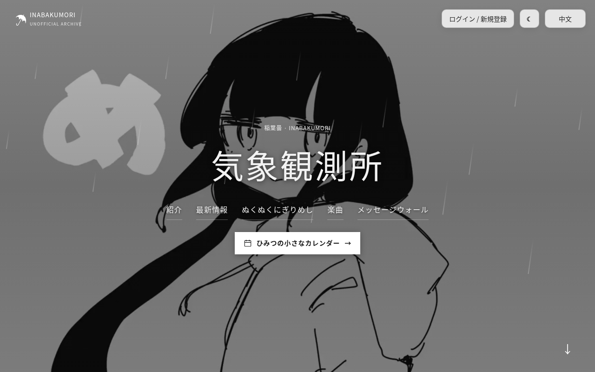
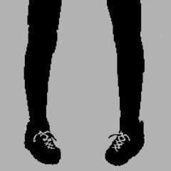
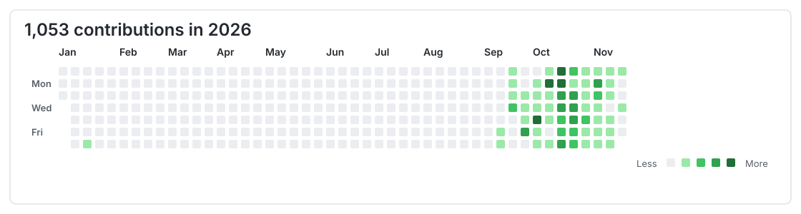

  

<h1 align="center">Osage</h1>

## 自己紹介 🩵

Osage です。中国出身で、現在はアメリカ・オレゴン州の高校に通っています。数学がいちばん好きで、物理や化学にも興味があります。浮かんだアイデアを、自分らしい小さな作品として形にするのが好きです。

**個人サイト：** [homepage-197933.gitlab.io](https://homepage-197933.gitlab.io/)

## 数学と興味 💜

とくに純粋数学に惹かれ、代数・数論・解析を学んでいます。数学的な証明の構造を理解することも好きで、一つの命題を少しずつ証明したり、考えどうしのつながりを見つけたり、議論を明確で厳密な形にまとめたりします。これらはいずれも学習中の興味であり、専門的な能力を主張するものではありません。

## 主なプロジェクト 🔷

### 01 / Weather Observation Station · 稲葉曇

🌧️ **稲葉曇 / inabakumori** さんのために作った、非公式の多言語ファンサイトです。楽曲情報や音楽の出典、クリエイターの近況をまとめています。

- 中国語・英語・日本語の楽曲ライブラリに検索・絞り込み・ブラウザ内のお気に入り保存。更新情報、イラスト、音楽リンクも掲載
- アカウント機能、メッセージウォール、ライト / ダークテーマ

**[サイトを見る](https://osagechan.top/)** · [GitHub リポジトリ](https://github.com/9178osage/inabakumori-site)

個人で制作した非公式のファンプロジェクトです。稲葉曇さん、イラスト制作者、関連する公式レーベルやプラットフォームとは関係ありません。

---

### 02 / Eugene Desk

🗂️ オレゴン州ユージーンの学生向けに作った、多言語対応のデスク型ダッシュボードです。今日の予定、授業、地域やキャンパスの情報を一か所にまとめます。

- 今日のタスク、週間時間割、次の授業のカウントダウン、天気、校内・街の情報
- 小学生から大学まで 4 つの学段と 6 言語に対応。ログイン不要でブラウザ内に保存し、GPA 見積もり、カレンダー・画像を書き出し可能

**[デモを見る](https://eugene-desk.vercel.app/)** · [GitHub リポジトリ](https://github.com/9178osage/13th-desk)

GPA は参考値で、正式な成績は学校の記録を確認してください。カレンダーや営業時間なども、各機関の公式情報をご確認ください。

---

### 03 / 小辫子酱 · Codex Desktop Pet

🐾 Codex をモチーフにした非公式のデスクトップペットです。かわいいキャラクター、オリジナルアニメーション、動作デモ、ダウンロード用素材が含まれます。

- キャラクターのオリジナルアニメーションと、直接見られる MP4 の動作デモ
- ダウンロードできるデスクトップペット素材

[GitHub リポジトリ](https://github.com/9178osage/xiaobianzijiang-codex-pet) · [デモを見る](https://github.com/9178osage/xiaobianzijiang-codex-pet/blob/main/xiaodai-actions.mp4) · **[v1.0.0 をダウンロード](https://github.com/9178osage/xiaobianzijiang-codex-pet/releases/tag/v1.0.0)**

個人が制作した非公式のファン作品で、OpenAI の公式製品ではありません。OpenAI との関係や公認を示すものでもありません。

## プロジェクトの作り方 ✨

アイデア、機能要件、デザイン方針は主に自分で決めています。コードの大半は AI の支援によって生成され、実際に使う・試す・フィードバックする・改良を重ねる作業は自分が担当します。コードの確認には、異なる AI モデルを使うこともあります。

こうした確認は問題の発見に役立ちますが、**コードが絶対に安全で、完全にエラーがないことを保証するものではありません**。

## 音楽 🎵

Vocaloid が好きで、とくに **稲葉曇 / inabakumori** さんと **DECO\*27** さんの曲をよく聴いています。

 &nbsp; 

個人の好みを紹介しているだけで、公式なコラボや権利の許諾を示すものではありません。音楽再生サービスでもありません。

## 連絡と応援 💛

プロジェクトへの質問や改善案は、各リポジトリの Issues へお願いします。使ってみること、役立つ意見を伝えること、気に入ったリポジトリへ Star を付けることが、大きな応援になります。

プライバシーを守るため、メールアドレスや個人用のメッセージング ID はここには載せていません。

## GitHub への貢献 · 2026

**1,053 件の貢献**

| 活動概要 | 貢献の内訳 |
| --- | --- |
| **貢献先**  [inabakumori-site](https://github.com/9178osage/inabakumori-site)、[13th-desk](https://github.com/9178osage/13th-desk)、[luopian](https://github.com/9178osage/luopian)、ほか 4 公開リポジトリ | **コミット：1,044（99%）** **Issues：0** **Pull requests：1（1%未満）** **コードレビュー：0** |
