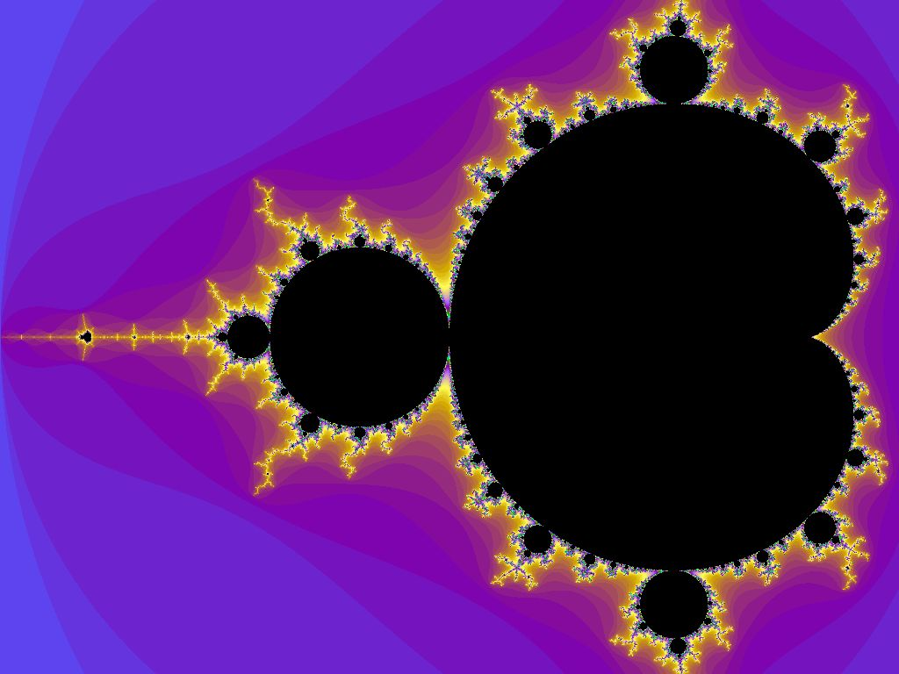
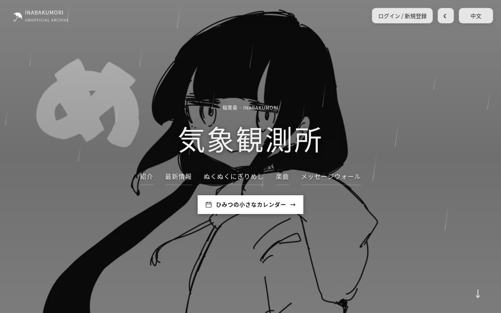
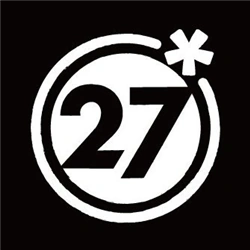
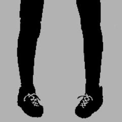
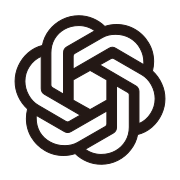

  

<h1 align="center">? Osage ?</h1>

## 自己紹介 🩵

私はOsageですか？中国出身で、いまはアメリカ・オレゴン州の高校に通っています。いちばん好きなのは数学で、物理や化学にもとても興味があります。ボカロが大好きで、普段からよく聴いています。ELD（英語学習者向けの授業）を受けて、英語が上達しています。プロジェクトの大半は AI の力を借りて作っています。

## 好きなこと 💜

命題を自分の手で証明すること、一見関係なさそうな考えどうしのつながりを見つけること、そして推論を一歩ずつ、厳密に、矛盾なく組み立てることが好きです。

特に惹かれるのは、応用数学よりも**純粋数学**です。代数、数論、解析学、そして証明そのものの組み立てに興味があります。どれもまだ勉強中で、精通しているわけではありませんが、抽象的な考えには説明しきれない魅力を感じます。

## プロジェクト 🔷

### 01 / Weather Observation Station · 稲葉曇

🌧️ **稲葉曇 / inabakumori** さんの非公式ファンサイトを作りました。いちばん自分らしさが出ているプロジェクトです。

クリエイターの近況をまとめて掲載しているほか、楽曲情報や音楽へのリンク、イラストギャラリー、アカウント機能、メッセージウォールもあります。画面は中国語・英語・日本語に対応しています。

**[観測所へ ↗](https://osagechan.top/)** &nbsp; · &nbsp; [リポジトリ](https://github.com/9178osage/inabakumori-site)

個人のファン活動です。稲葉曇さん、掲載イラストの作者、関連する公式レーベルやプラットフォームとは関係ありません。

---

### 02 / 小辫子酱 · Codex Desktop Pet

🐾 デスクトップペットを作る非公式プロジェクトです。かわいいキャラクターとカスタムアニメーションに加えて、動作デモやダウンロードできる素材パックも用意しています。

**[デスクトップペットをダウンロード ↗](https://github.com/9178osage/xiaobianzijiang-codex-pet)**

個人の非公式なファン作品で、OpenAI の公式製品ではありません。OpenAI との公式な関係はなく、公認も受けていません。

## 音楽 🎵

いちばん好きなクリエイターは、**稲葉曇 / inabakumori** さんと **DECO\*27** さんの二人です。

 &nbsp; 

好きな音楽を紹介しているだけで、公式のコラボではありません。オンライン再生や再生履歴の機能はありません。

## プロジェクト制作 ✨

 &nbsp;
 &nbsp;
 &nbsp;
 
 &nbsp;
 &nbsp;
 &nbsp;

各ロゴはツールの識別のために掲載しており、各ブランドとの公式な関係や推薦を示すものではありません。

正直なところ、コンピューターの知識はまだ初歩的で、大学でコンピューターサイエンスを専攻するつもりもありません。**アイデアや機能、デザインは自分で決めて、コードの大部分は AI に書いてもらっています。** そのあと自分で使ってみて、感想や改善点を伝え、納得できるまで何度も直します。

安全性や信頼性も大切にしているので、複数の異なる AI モデルでコードを相互チェックすることがよくあります。問題を見つける助けにはなりますが、コードに脆弱性や不具合がないことまで**保証できるわけではありません**。

## 応援してね 💛

**If you enjoy my projects, feel free to support me.**

どれも趣味でつくっている作品ですが、複数の高度な AI モデルでコードを書いたりチェックしたりすると、費用がかかります。応援していただけたらとてもうれしいです。もちろん、無理のない範囲で大丈夫です。実際に使ってみる、感想や改善案を送る、リポジトリにスターを付ける――それだけでも大きな励みになります。

寄付のリンクはまだ載せていません。

## 連絡先 ✉️

作品の話でも、共通の趣味の話でも、ちょっとした挨拶でも、気軽にメールしてください。

**[throne-uplift.3b@icloud.com](mailto:throne-uplift.3b@icloud.com)** &nbsp; · &nbsp; QQ: 3976621619
