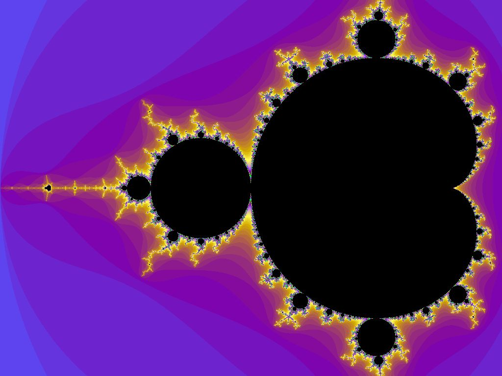
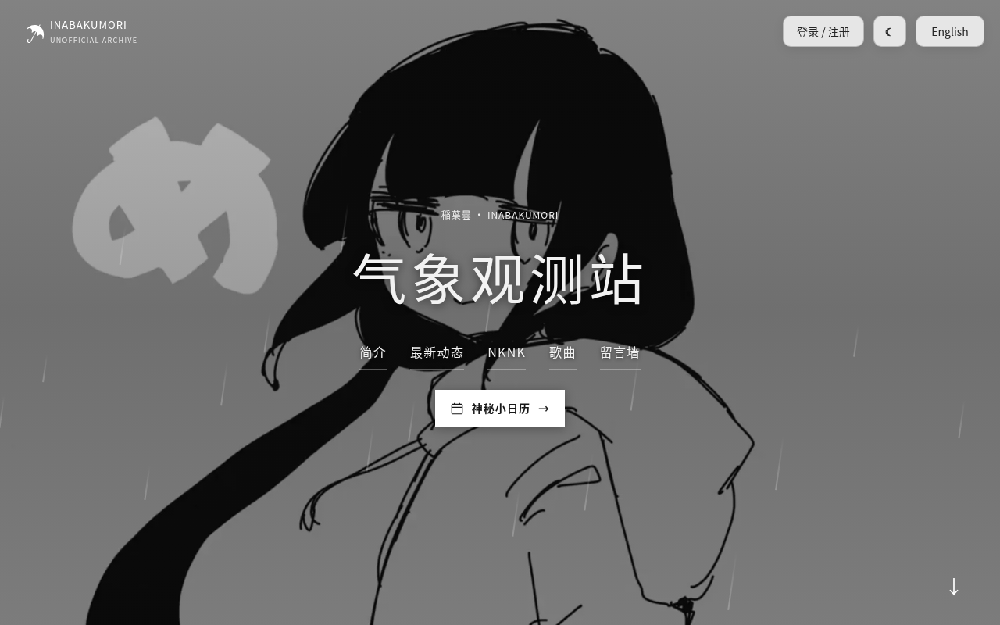
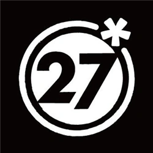
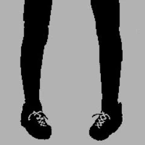
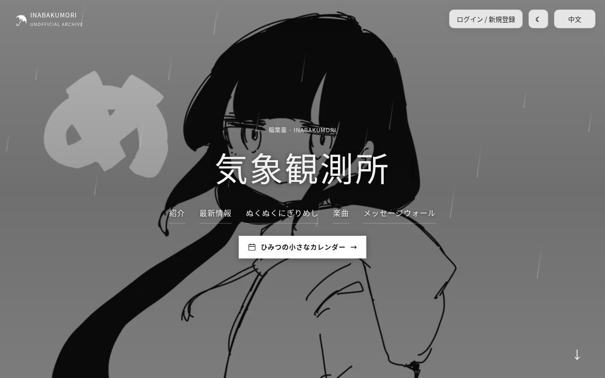
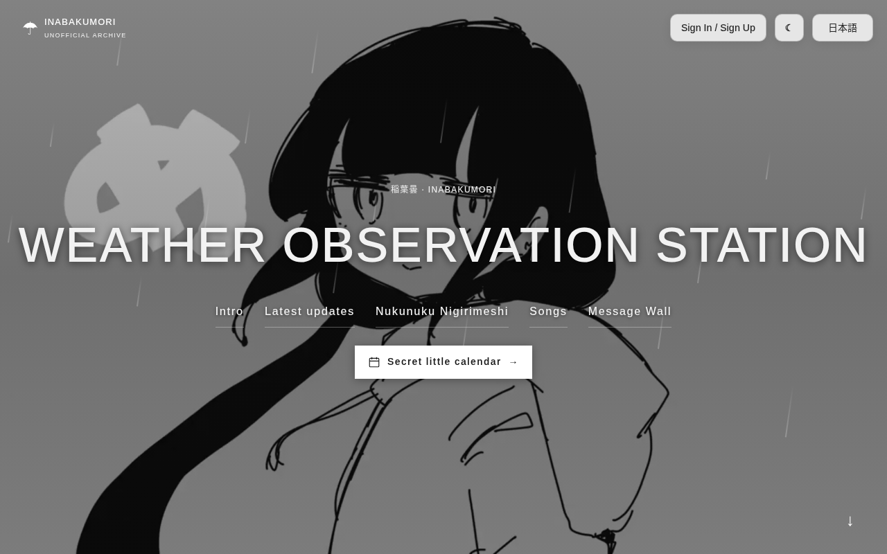

  

<h1 align="center">? Osage ?</h1>

  Click a language to expand · 点击语言展开 · 言語をクリックして開く

<strong>🇨🇳 简体中文</strong>

## 关于我 🩵

我是 Osage？我来自中国，现在在美国俄勒冈州读高中。我最喜欢数学，对物理和化学也很感兴趣，平时很爱听 V 家的歌。我的英语正在通过 ELD（面向英语学习者的英语课）不断进步，大部分项目都是借助 AI 完成的。

## 我的爱好 💜

我喜欢亲手把一个命题证出来，喜欢发现看似不相关的想法之间藏着的联系，也喜欢把推理一步步理清，让它严谨、自洽。

比起应用数学，我更偏爱**纯数学**：代数、数论、分析学，还有证明本身的结构。这些我都还在慢慢学，谈不上精通，但抽象的想法本身就让我着迷，那种吸引力我也说不太清。

## 项目 🔷

### 01 / Weather Observation Station · 稲葉曇

🌧️ 这是我为 **稲葉曇 / inabakumori** 做的非官方粉丝站，也是最像我的一个项目。

站里有歌曲资料和音乐链接、整理后的创作者动态、插画展示和中英日三语界面，还有账号功能和留言墙。

**[进入观测站 ↗](https://osagechan.top/)** &nbsp; · &nbsp; [查看仓库](https://github.com/9178osage/inabakumori-site)

个人粉丝作品，与稲葉曇本人、站内插画作者及相关官方厂牌或平台均无关联。

---

### 02 / 小辫子酱 · Codex Desktop Pet

🐾 这是一个非官方桌面宠物项目，包含可爱的角色形象、自定义动画、动作演示和可下载的资源包。

**[下载桌宠 ↗](https://github.com/9178osage/xiaobianzijiang-codex-pet)**

个人粉丝创作，不是 OpenAI 的官方产品，与 OpenAI 没有关联，也未获其认可。

## 音乐 🎵

最喜欢的两位创作者是 **稲葉曇 / inabakumori** 和 **DECO\*27**。

 &nbsp; 

这里只是分享个人喜好，不是官方合作，也没有在线播放或听歌记录。

## 项目制作 ✨

 &nbsp;
 &nbsp;
 &nbsp;
 
 &nbsp;
 &nbsp;
 &nbsp;

这些标志仅用于识别工具，不代表与相关品牌存在官方关联或获得其背书。

老实说，我的计算机基础还很浅，大学也不打算学计算机。我的做法是：**想法、功能和设计由我来定，大部分代码交给 AI 写**，然后我自己试用、提意见，一遍遍改到满意为止。

我很在意安全和可靠，所以常让几个不同的 AI 模型交叉检查代码。这能帮忙发现问题，但**不能保证代码一定安全、没有错误**。

## 支持我 💛

**If you enjoy my projects, feel free to support me.**

这些项目都是出于兴趣做的，不过用好几个高级 AI 模型写代码、做检查，确实会产生一些费用。如果你愿意支持，我会非常开心；当然完全不用有压力——试用一下、提点建议，或者给仓库点个 Star，对我来说都是很大的鼓励。

这里暂时还没有放捐赠链接。

## 联系我 ✉️

想聊聊项目、共同的爱好，或者只是打个招呼，都欢迎给我发邮件：

**[throne-uplift.3b@icloud.com](mailto:throne-uplift.3b@icloud.com)** &nbsp; · &nbsp; QQ: 3976621619

<strong>🇯🇵 日本語</strong>

## 自己紹介 🩵

私はOsageですか？中国出身で、いまはアメリカ・オレゴン州の高校に通っています。いちばん好きなのは数学で、物理や化学にもとても興味があります。ボカロが大好きで、普段からよく聴いています。ELD（英語学習者向けの授業）を受けて、英語が上達しています。プロジェクトの大半は AI の力を借りて作っています。

## 好きなこと 💜

命題を自分の手で証明すること、一見関係なさそうな考えどうしのつながりを見つけること、そして推論を一歩ずつ、厳密に、矛盾なく組み立てることが好きです。

特に惹かれるのは、応用数学よりも**純粋数学**です。代数、数論、解析学、そして証明そのものの組み立てに興味があります。どれもまだ勉強中で、精通しているわけではありませんが、抽象的な考えには説明しきれない魅力を感じます。

## プロジェクト 🔷

### 01 / Weather Observation Station · 稲葉曇

🌧️ **稲葉曇 / inabakumori** さんの非公式ファンサイトを作りました。いちばん自分らしさが出ているプロジェクトです。

クリエイターの近況をまとめて掲載しているほか、楽曲情報や音楽へのリンク、イラストギャラリー、アカウント機能、メッセージウォールもあります。画面は中国語・英語・日本語に対応しています。

**[観測所へ ↗](https://osagechan.top/)** &nbsp; · &nbsp; [リポジトリ](https://github.com/9178osage/inabakumori-site)

個人のファン活動です。稲葉曇さん、掲載イラストの作者、関連する公式レーベルやプラットフォームとは関係ありません。

---

### 02 / 小辫子酱 · Codex Desktop Pet

🐾 デスクトップペットを作る非公式プロジェクトです。かわいいキャラクターとカスタムアニメーションに加えて、動作デモやダウンロードできる素材パックも用意しています。

**[デスクトップペットをダウンロード ↗](https://github.com/9178osage/xiaobianzijiang-codex-pet)**

個人の非公式なファン作品で、OpenAI の公式製品ではありません。OpenAI との公式な関係はなく、公認も受けていません。

## 音楽 🎵

いちばん好きなクリエイターは、**稲葉曇 / inabakumori** さんと **DECO\*27** さんの二人です。

 &nbsp; 

好きな音楽を紹介しているだけで、公式のコラボではありません。オンライン再生や再生履歴の機能はありません。

## プロジェクト制作 ✨

 &nbsp;
 &nbsp;
 &nbsp;
 
 &nbsp;
 &nbsp;
 &nbsp;

各ロゴはツールの識別のために掲載しており、各ブランドとの公式な関係や推薦を示すものではありません。

正直なところ、コンピューターの知識はまだ初歩的で、大学でコンピューターサイエンスを専攻するつもりもありません。**アイデアや機能、デザインは自分で決めて、コードの大部分は AI に書いてもらっています。** そのあと自分で使ってみて、感想や改善点を伝え、納得できるまで何度も直します。

安全性や信頼性も大切にしているので、複数の異なる AI モデルでコードを相互チェックすることがよくあります。問題を見つける助けにはなりますが、コードに脆弱性や不具合がないことまで**保証できるわけではありません**。

## 応援してね 💛

**If you enjoy my projects, feel free to support me.**

どれも趣味でつくっている作品ですが、複数の高度な AI モデルでコードを書いたりチェックしたりすると、費用がかかります。応援していただけたらとてもうれしいです。もちろん、無理のない範囲で大丈夫です。実際に使ってみる、感想や改善案を送る、リポジトリにスターを付ける――それだけでも大きな励みになります。

寄付のリンクはまだ載せていません。

## 連絡先 ✉️

作品の話でも、共通の趣味の話でも、ちょっとした挨拶でも、気軽にメールしてください。

**[throne-uplift.3b@icloud.com](mailto:throne-uplift.3b@icloud.com)** &nbsp; · &nbsp; QQ: 3976621619

<strong>🇺🇸 English</strong>

## About me 🩵

I'm Osage? I'm from China and now attend high school in Oregon, USA. Math is my favorite subject, and I'm also very interested in physics and chemistry. I love Vocaloid music and listen to it often. I'm improving my English through English Language Development (ELD) classes for English learners. I build most of my projects with help from AI.

## My interests 💜

I enjoy proving mathematical statements myself, finding connections between ideas that seem unrelated, and working through my reasoning step by step until it is rigorous and consistent.

I'm more drawn to **pure mathematics** than to applied math. I'm interested in algebra, number theory, analysis, and the structure of proofs. I'm still learning these topics and haven't mastered them, but abstract ideas themselves fascinate me in a way I can't quite explain.

## Projects 🔷

### 01 / Weather Observation Station · 稲葉曇

🌧️ I made this unofficial fan site for **稲葉曇 / inabakumori**. It's the project that feels most like me.

It has song information and music links, curated creator updates, an illustration gallery, account features, and a message wall. The interface is available in Chinese, English, and Japanese.

**[Visit the station ↗](https://osagechan.top/)** &nbsp; · &nbsp; [View repository](https://github.com/9178osage/inabakumori-site)

A personal fan project with no ties to inabakumori, the featured illustrators, or related official labels or platforms.

---

### 02 / 小辫子酱 · Codex Desktop Pet

🐾 This is an unofficial desktop pet project with a cute character and custom animations, plus an animation demo and a downloadable resource pack.

**[Download the desktop pet ↗](https://github.com/9178osage/xiaobianzijiang-codex-pet)**

A personal fan creation; not an official OpenAI product, and not affiliated with or endorsed by OpenAI.

## Music 🎵

My two favorite artists are **稲葉曇 / inabakumori** and **DECO\*27**.

 &nbsp; 

I'm just sharing music I love. This is not an official collaboration. There is no online music playback or listening history here.

## Making projects ✨

 &nbsp;
 &nbsp;
 &nbsp;
 
 &nbsp;
 &nbsp;
 &nbsp;

Logos identify the tools only; they do not imply official affiliation or endorsement.

To be honest, my computer knowledge is still pretty basic, and I don't plan to study computer science in college. **I decide on the ideas, features, and design, and AI writes most of the code.** Then I test the projects myself, give feedback, and keep revising until I'm happy with the result.

I care about security and reliability, so I often have several different AI models cross-check the code. This can help catch problems, but it **can't guarantee the code is safe or bug-free**.

## Support me 💛

**If you enjoy my projects, feel free to support me.**

These are all hobby projects, but using several advanced AI models to write and check the code does cost money. If you'd like to support my work, I'd really appreciate it. Please don't feel any pressure. Trying out a project, suggesting an improvement, or starring a repo would mean a lot to me, too.

There's no donation link here yet.

## Contact ✉️

Want to talk about a project, a shared interest, or just say hi? Feel free to email me:

**[throne-uplift.3b@icloud.com](mailto:throne-uplift.3b@icloud.com)** &nbsp; · &nbsp; QQ: 3976621619

