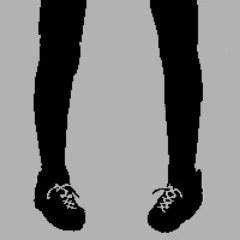
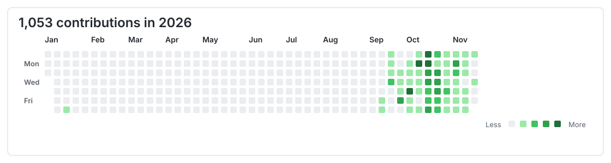
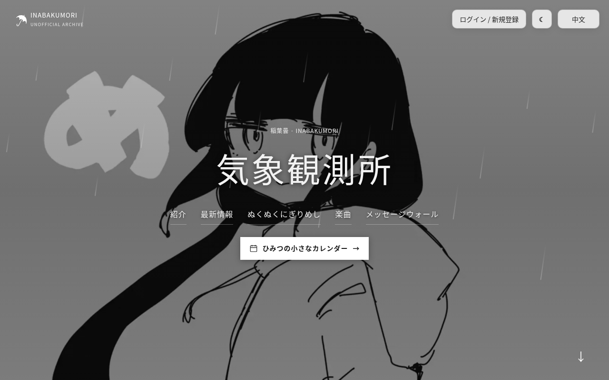
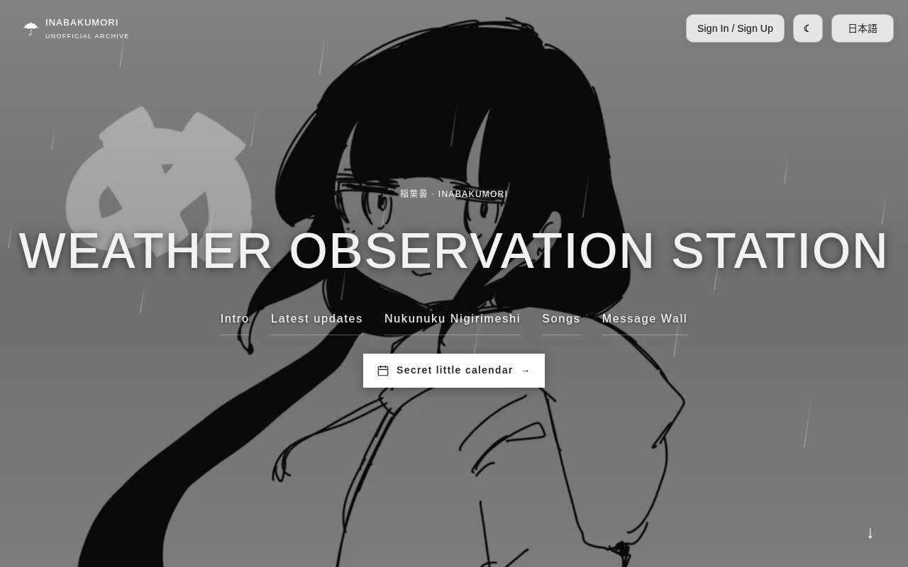

  

<h1 align="center">Osage</h1>

  点击选择语言 · Select a language · 言語を選択

<strong>🇨🇳 简体中文</strong>

## 关于我 🩵

我是 Osage，来自中国，现在在美国俄勒冈州读高中。数学是我最喜欢的学科，也对物理和化学很感兴趣。我喜欢把想到的点子做成有个人特色的小项目。

**个人主站：** [homepage-197933.gitlab.io](https://homepage-197933.gitlab.io/)

## 数学与兴趣 💜

我尤其喜欢纯数学，正在学习代数、数论和分析，也喜欢理解数学证明的结构。我享受慢慢证明一个命题、寻找想法之间的联系，把推理整理得清楚严谨；这些都仍是学习中的兴趣，并不是专业能力的宣称。

## 精选项目 🔷

### 01 / Weather Observation Station · 稲葉曇

🌧️ 一个为 **稲葉曇 / inabakumori** 制作的非官方多语粉丝站，整理歌曲资料、音乐来源与创作者动态。

- 中英日歌曲库，支持搜索、筛选和浏览器内收藏；另有整理后的动态、插画画廊和音乐链接
- 账号、留言墙，以及浅色 / 深色主题

**[在线体验](https://osagechan.top/)** · [GitHub 仓库](https://github.com/9178osage/inabakumori-site)

个人非官方粉丝项目，与稲葉曇、插画作者及相关官方厂牌或平台均无关联。

---

### 02 / Eugene Desk

🗂️ 一个面向美国俄勒冈州尤金地区学生的多语书桌仪表盘，把每天要做的事、课程与校园资源集中在一个页面。

- 今日待办、周课表、下一节课倒计时、天气，以及校园与城镇资源
- 覆盖小学到大学四个学段和六种语言；无需账号，支持本地数据、GPA 估算和日历 / 图片导出

**[在线体验](https://eugene-desk.vercel.app/)** · [GitHub 仓库](https://github.com/9178osage/13th-desk)

GPA 仅为估算，正式成绩以学校记录为准；校历与开放时间等信息请以相关机构官网为准。

---

### 03 / 小辫子酱 · Codex Desktop Pet

🐾 一个以 Codex 为灵感的非官方桌面宠物项目，包含可爱的角色形象、自定义动画、动作演示和可下载资源包。

- 自定义角色动画，并提供可直接查看的 MP4 动作演示
- 提供桌宠资源包下载

[GitHub 仓库](https://github.com/9178osage/xiaobianzijiang-codex-pet) · [观看演示](https://github.com/9178osage/xiaobianzijiang-codex-pet/blob/main/xiaodai-actions.mp4) · **[下载 v1.0.0](https://github.com/9178osage/xiaobianzijiang-codex-pet/releases/tag/v1.0.0)**

个人非官方粉丝作品，不是 OpenAI 的官方产品，与 OpenAI 无关联，也未获其认可。

## 我如何做项目 ✨

项目想法、功能需求和设计方向主要由我决定；大部分代码由 AI 辅助生成。我负责实际试用、测试、反馈和反复改进，也会让不同 AI 模型帮助检查代码。

这些检查能发现问题，但**不能保证代码绝对安全或完全没有错误**。

## 音乐 🎵

我喜欢 Vocaloid，最常听的是 **稲葉曇 / inabakumori** 和 **DECO\*27**。

 &nbsp; 

这里只分享个人喜好，不代表官方合作或获得相关权利许可；这里也不是音乐播放服务。

## 联系与支持 💛

项目反馈、问题和改进建议都可以留在对应仓库的 Issues；试用项目、分享有用的反馈或给喜欢的仓库点 Star，都是很好的支持。

为减少隐私暴露，这里不公开邮箱地址或即时通讯号码。

## GitHub 贡献 · 2026

**1,053 次贡献**

| 活动概览 | 贡献构成 |
| --- | --- |
| **贡献到**  [inabakumori-site](https://github.com/9178osage/inabakumori-site)、[13th-desk](https://github.com/9178osage/13th-desk)、[luopian](https://github.com/9178osage/luopian)，以及另外 4 个公开仓库 | **提交：1,044（99%）** **Issues：0** **Pull requests：1（不到 1%）** **代码审查：0** |

<strong>🇯🇵 日本語</strong>

## 自己紹介 🩵

Osage です。中国出身で、現在はアメリカ・オレゴン州の高校に通っています。数学がいちばん好きで、物理や化学にも興味があります。浮かんだアイデアを、自分らしい小さな作品として形にするのが好きです。

**個人サイト：** [homepage-197933.gitlab.io](https://homepage-197933.gitlab.io/)

## 数学と興味 💜

とくに純粋数学に惹かれ、代数・数論・解析を学んでいます。数学的な証明の構造を理解することも好きで、一つの命題を少しずつ証明したり、考えどうしのつながりを見つけたり、議論を明確で厳密な形にまとめたりします。これらはいずれも学習中の興味であり、専門的な能力を主張するものではありません。

## 主なプロジェクト 🔷

### 01 / Weather Observation Station · 稲葉曇

🌧️ **稲葉曇 / inabakumori** さんのために作った、非公式の多言語ファンサイトです。楽曲情報や音楽の出典、クリエイターの近況をまとめています。

- 中国語・英語・日本語の楽曲ライブラリに検索・絞り込み・ブラウザ内のお気に入り保存。更新情報、イラスト、音楽リンクも掲載
- アカウント機能、メッセージウォール、ライト / ダークテーマ

**[サイトを見る](https://osagechan.top/)** · [GitHub リポジトリ](https://github.com/9178osage/inabakumori-site)

個人で制作した非公式のファンプロジェクトです。稲葉曇さん、イラスト制作者、関連する公式レーベルやプラットフォームとは関係ありません。

---

### 02 / Eugene Desk

🗂️ オレゴン州ユージーンの学生向けに作った、多言語対応のデスク型ダッシュボードです。今日の予定、授業、地域やキャンパスの情報を一か所にまとめます。

- 今日のタスク、週間時間割、次の授業のカウントダウン、天気、校内・街の情報
- 小学生から大学まで 4 つの学段と 6 言語に対応。ログイン不要でブラウザ内に保存し、GPA 見積もり、カレンダー・画像を書き出し可能

**[デモを見る](https://eugene-desk.vercel.app/)** · [GitHub リポジトリ](https://github.com/9178osage/13th-desk)

GPA は参考値で、正式な成績は学校の記録を確認してください。カレンダーや営業時間なども、各機関の公式情報をご確認ください。

---

### 03 / 小辫子酱 · Codex Desktop Pet

🐾 Codex をモチーフにした非公式のデスクトップペットです。かわいいキャラクター、オリジナルアニメーション、動作デモ、ダウンロード用素材が含まれます。

- キャラクターのオリジナルアニメーションと、直接見られる MP4 の動作デモ
- ダウンロードできるデスクトップペット素材

[GitHub リポジトリ](https://github.com/9178osage/xiaobianzijiang-codex-pet) · [デモを見る](https://github.com/9178osage/xiaobianzijiang-codex-pet/blob/main/xiaodai-actions.mp4) · **[v1.0.0 をダウンロード](https://github.com/9178osage/xiaobianzijiang-codex-pet/releases/tag/v1.0.0)**

個人が制作した非公式のファン作品で、OpenAI の公式製品ではありません。OpenAI との関係や公認を示すものでもありません。

## プロジェクトの作り方 ✨

アイデア、機能要件、デザイン方針は主に自分で決めています。コードの大半は AI の支援によって生成され、実際に使う・試す・フィードバックする・改良を重ねる作業は自分が担当します。コードの確認には、異なる AI モデルを使うこともあります。

こうした確認は問題の発見に役立ちますが、**コードが絶対に安全で、完全にエラーがないことを保証するものではありません**。

## 音楽 🎵

Vocaloid が好きで、とくに **稲葉曇 / inabakumori** さんと **DECO\*27** さんの曲をよく聴いています。

 &nbsp; 

個人の好みを紹介しているだけで、公式なコラボや権利の許諾を示すものではありません。音楽再生サービスでもありません。

## 連絡と応援 💛

プロジェクトへの質問や改善案は、各リポジトリの Issues へお願いします。使ってみること、役立つ意見を伝えること、気に入ったリポジトリへ Star を付けることが、大きな応援になります。

プライバシーを守るため、メールアドレスや個人用のメッセージング ID はここには載せていません。

## GitHub への貢献 · 2026

**1,053 件の貢献**

| 活動概要 | 貢献の内訳 |
| --- | --- |
| **貢献先**  [inabakumori-site](https://github.com/9178osage/inabakumori-site)、[13th-desk](https://github.com/9178osage/13th-desk)、[luopian](https://github.com/9178osage/luopian)、ほか 4 公開リポジトリ | **コミット：1,044（99%）** **Issues：0** **Pull requests：1（1%未満）** **コードレビュー：0** |

<strong>🇺🇸 English</strong>

## About me 🩵

I'm Osage. I'm from China and currently a high school student in Oregon, USA. Math is my favorite subject, and I'm also interested in physics and chemistry. I enjoy turning ideas into small, personal projects.

**Personal website:** [homepage-197933.gitlab.io](https://homepage-197933.gitlab.io/)

## Mathematics & interests 💜

I'm especially drawn to pure mathematics. I'm learning algebra, number theory, and analysis, and I enjoy understanding the structure of mathematical proofs. Working through a statement, finding connections between ideas, and making an argument clear and rigorous are things I like to practice. These are interests I'm still learning, not claims of expertise.

## Featured projects 🔷

### 01 / Weather Observation Station · 稲葉曇

🌧️ An unofficial multilingual fan site for **稲葉曇 / inabakumori**, collecting song information, music sources, and curated creator updates.

- Chinese, English, and Japanese song library with search, filters, and browser-local favorites; plus updates, illustrations, and music links
- Accounts, a message wall, and light / dark themes

**[Visit the site](https://osagechan.top/)** · [GitHub repository](https://github.com/9178osage/inabakumori-site)

A personal, unofficial fan project with no affiliation with inabakumori, the featured illustrators, or related official labels and platforms.

---

### 02 / Eugene Desk

🗂️ A multilingual student dashboard for Eugene, Oregon, bringing daily tasks, classes, and campus resources together in a warm desk-style interface.

- Today's tasks, weekly timetable, next-class countdown, weather, and campus / town resources
- Four school levels and six languages; no login, browser-local data, GPA estimates, and calendar / image exports

**[Try the demo](https://eugene-desk.vercel.app/)** · [GitHub repository](https://github.com/9178osage/13th-desk)

GPA values are estimates, not official grades. Calendar dates, opening hours, and other local information should be checked against each institution's official site.

---

### 03 / 小辫子酱 · Codex Desktop Pet

🐾 An unofficial Codex-inspired desktop pet project with a cute character, custom animations, an animation demo, and a downloadable resource pack.

- Custom character animations with a viewable MP4 motion demo
- A downloadable desktop-pet resource pack

[GitHub repository](https://github.com/9178osage/xiaobianzijiang-codex-pet) · [Watch the demo](https://github.com/9178osage/xiaobianzijiang-codex-pet/blob/main/xiaodai-actions.mp4) · **[Download v1.0.0](https://github.com/9178osage/xiaobianzijiang-codex-pet/releases/tag/v1.0.0)**

A personal fan creation; not an official OpenAI product, and not affiliated with or endorsed by OpenAI.

## How I build ✨

I decide the project ideas, feature requirements, and design direction. Most of the code is generated with AI assistance, while I try the projects, test them, give feedback, and revise through repeated iterations. I also use different AI models to help review the code.

Those reviews can catch problems, but they **cannot guarantee that the code is secure or error-free**.

## Music 🎵

I love Vocaloid music, especially **稲葉曇 / inabakumori** and **DECO\*27**.

 &nbsp; 

This is a personal music preference, not an official collaboration or endorsement, and this profile is not a music-streaming service.

## Contact & support 💛

For project questions or ideas, leave feedback in the corresponding repository's Issues. Trying a project, sharing useful feedback, or starring a repository you enjoy is meaningful support.

To reduce privacy exposure, I do not publish an email address or instant-messaging number here.

## GitHub contributions · 2026

**1,053 contributions**

| Activity overview | Contribution mix |
| --- | --- |
| **Contributed to**  [inabakumori-site](https://github.com/9178osage/inabakumori-site), [13th-desk](https://github.com/9178osage/13th-desk), [luopian](https://github.com/9178osage/luopian), and 4 other public repositories | **Commits: 1,044 (99%)** **Issues: 0** **Pull requests: 1 (<1%)** **Code reviews: 0** |

