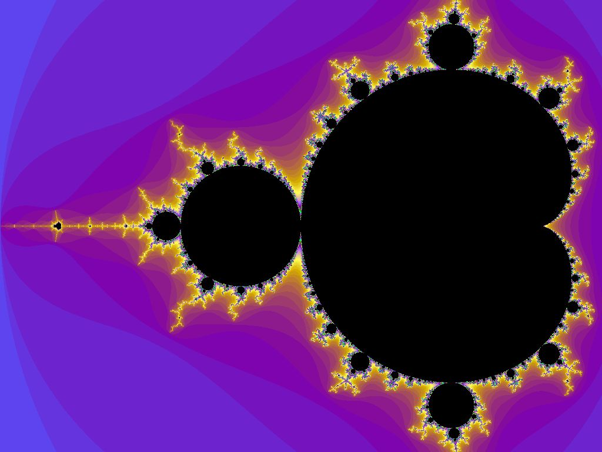
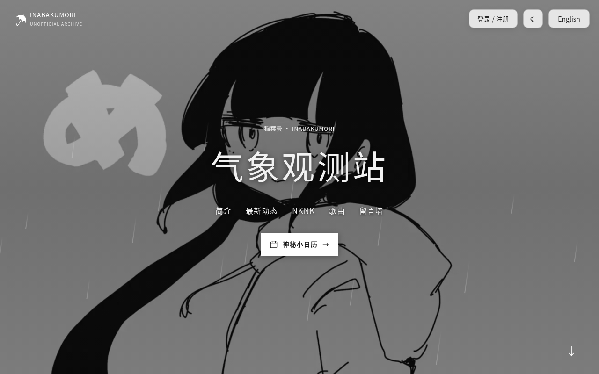
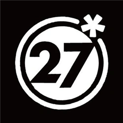
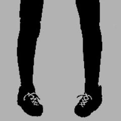

  

<h1 align="center">? Osage ?</h1>

## 关于我 🩵

我是 Osage？我来自中国，现在在美国俄勒冈州读高中。我最喜欢数学，对物理和化学也很感兴趣，平时很爱听 V 家的歌。我的英语正在通过 ELD（面向英语学习者的英语课）不断进步，大部分项目都是借助 AI 完成的。

## 我的爱好 💜

我喜欢亲手把一个命题证出来，喜欢发现看似不相关的想法之间藏着的联系，也喜欢把推理一步步理清，让它严谨、自洽。

比起应用数学，我更偏爱**纯数学**：代数、数论、分析学，还有证明本身的结构。这些我都还在慢慢学，谈不上精通，但抽象的想法本身就让我着迷，那种吸引力我也说不太清。

## 项目 🔷

### 01 / Weather Observation Station · 稲葉曇

🌧️ 这是我为 **稲葉曇 / inabakumori** 做的非官方粉丝站，也是最像我的一个项目。

站里有歌曲资料和音乐链接、整理后的创作者动态、插画展示和中英日三语界面，还有账号功能和留言墙。

**[进入观测站 ↗](https://osagechan.top/)** &nbsp; · &nbsp; [查看仓库](https://github.com/9178osage/inabakumori-site)

个人粉丝作品，与稲葉曇本人、站内插画作者及相关官方厂牌或平台均无关联。

---

### 02 / 小辫子酱 · Codex Desktop Pet

🐾 这是一个非官方桌面宠物项目，包含可爱的角色形象、自定义动画、动作演示和可下载的资源包。

**[下载桌宠 ↗](https://github.com/9178osage/xiaobianzijiang-codex-pet)**

个人粉丝创作，不是 OpenAI 的官方产品，与 OpenAI 没有关联，也未获其认可。

## 音乐 🎵

最喜欢的两位创作者是 **稲葉曇 / inabakumori** 和 **DECO\*27**。

 &nbsp; 

这里只是分享个人喜好，不是官方合作，也没有在线播放或听歌记录。

## 项目制作 ✨

 &nbsp;
 &nbsp;
 &nbsp;
 
 &nbsp;
 &nbsp;
 &nbsp;

这些标志仅用于识别工具，不代表与相关品牌存在官方关联或获得其背书。

老实说，我的计算机基础还很浅，大学也不打算学计算机。我的做法是：**想法、功能和设计由我来定，大部分代码交给 AI 写**，然后我自己试用、提意见，一遍遍改到满意为止。

我很在意安全和可靠，所以常让几个不同的 AI 模型交叉检查代码。这能帮忙发现问题，但**不能保证代码一定安全、没有错误**。

## 支持我 💛

**If you enjoy my projects, feel free to support me.**

这些项目都是出于兴趣做的，不过用好几个高级 AI 模型写代码、做检查，确实会产生一些费用。如果你愿意支持，我会非常开心；当然完全不用有压力——试用一下、提点建议，或者给仓库点个 Star，对我来说都是很大的鼓励。

这里暂时还没有放捐赠链接。

## 联系我 ✉️

想聊聊项目、共同的爱好，或者只是打个招呼，都欢迎给我发邮件：

**[throne-uplift.3b@icloud.com](mailto:throne-uplift.3b@icloud.com)** &nbsp; · &nbsp; QQ: 3976621619
