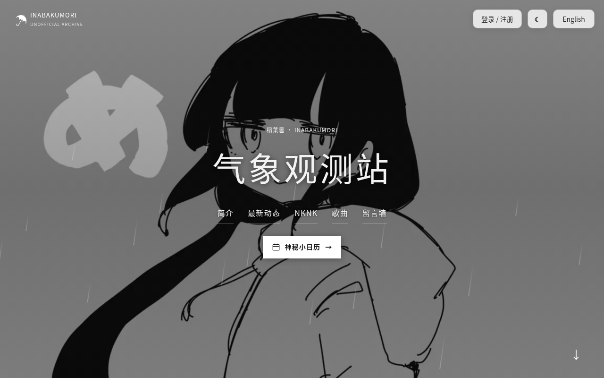
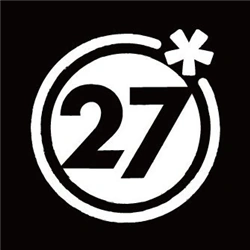
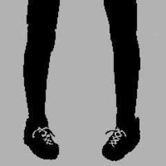

  

<h1 align="center">Osage</h1>

## 关于我 🩵

我是 Osage，来自中国，现在在美国俄勒冈州读高中。数学是我最喜欢的学科，也对物理和化学很感兴趣。我喜欢把想到的点子做成有个人特色的小项目。

**个人主站：** [homepage-197933.gitlab.io](https://homepage-197933.gitlab.io/)

## 数学与兴趣 💜

我尤其喜欢纯数学，正在学习代数、数论和分析，也喜欢理解数学证明的结构。我享受慢慢证明一个命题、寻找想法之间的联系，把推理整理得清楚严谨；这些都仍是学习中的兴趣，并不是专业能力的宣称。

## 精选项目 🔷

### 01 / Weather Observation Station · 稲葉曇

🌧️ 一个为 **稲葉曇 / inabakumori** 制作的非官方多语粉丝站，整理歌曲资料、音乐来源与创作者动态。

- 中英日歌曲库，支持搜索、筛选和浏览器内收藏；另有整理后的动态、插画画廊和音乐链接
- 账号、留言墙，以及浅色 / 深色主题

**[在线体验](https://osagechan.top/)** · [GitHub 仓库](https://github.com/9178osage/inabakumori-site)

个人非官方粉丝项目，与稲葉曇、插画作者及相关官方厂牌或平台均无关联。

---

### 02 / Eugene Desk

🗂️ 一个面向美国俄勒冈州尤金地区学生的多语书桌仪表盘，把每天要做的事、课程与校园资源集中在一个页面。

- 今日待办、周课表、下一节课倒计时、天气，以及校园与城镇资源
- 覆盖小学到大学四个学段和六种语言；无需账号，支持本地数据、GPA 估算和日历 / 图片导出

**[在线体验](https://eugene-desk.vercel.app/)** · [GitHub 仓库](https://github.com/9178osage/13th-desk)

GPA 仅为估算，正式成绩以学校记录为准；校历与开放时间等信息请以相关机构官网为准。

---

### 03 / 小辫子酱 · Codex Desktop Pet

🐾 一个以 Codex 为灵感的非官方桌面宠物项目，包含可爱的角色形象、自定义动画、动作演示和可下载资源包。

- 自定义角色动画，并提供可直接查看的 MP4 动作演示
- 提供桌宠资源包下载

[GitHub 仓库](https://github.com/9178osage/xiaobianzijiang-codex-pet) · [观看演示](https://github.com/9178osage/xiaobianzijiang-codex-pet/blob/main/xiaodai-actions.mp4) · **[下载 v1.0.0](https://github.com/9178osage/xiaobianzijiang-codex-pet/releases/tag/v1.0.0)**

个人非官方粉丝作品，不是 OpenAI 的官方产品，与 OpenAI 无关联，也未获其认可。

## 我如何做项目 ✨

项目想法、功能需求和设计方向主要由我决定；大部分代码由 AI 辅助生成。我负责实际试用、测试、反馈和反复改进，也会让不同 AI 模型帮助检查代码。

这些检查能发现问题，但**不能保证代码绝对安全或完全没有错误**。

## 音乐 🎵

我喜欢 Vocaloid，最常听的是 **稲葉曇 / inabakumori** 和 **DECO\*27**。

 &nbsp; 

这里只分享个人喜好，不代表官方合作或获得相关权利许可；这里也不是音乐播放服务。

## 联系与支持 💛

项目反馈、问题和改进建议都可以留在对应仓库的 Issues；试用项目、分享有用的反馈或给喜欢的仓库点 Star，都是很好的支持。

为减少隐私暴露，这里不公开邮箱地址或即时通讯号码。
